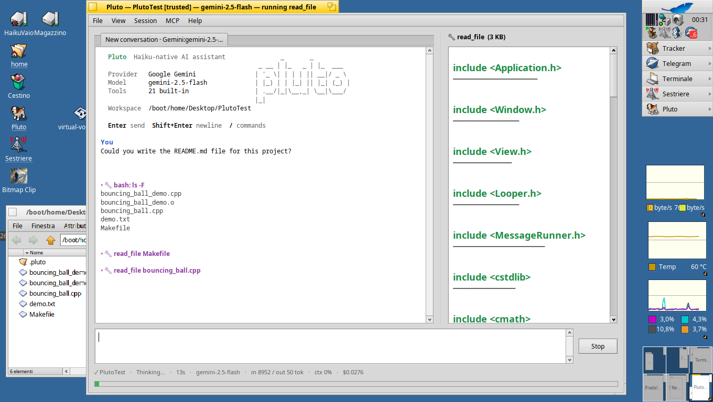
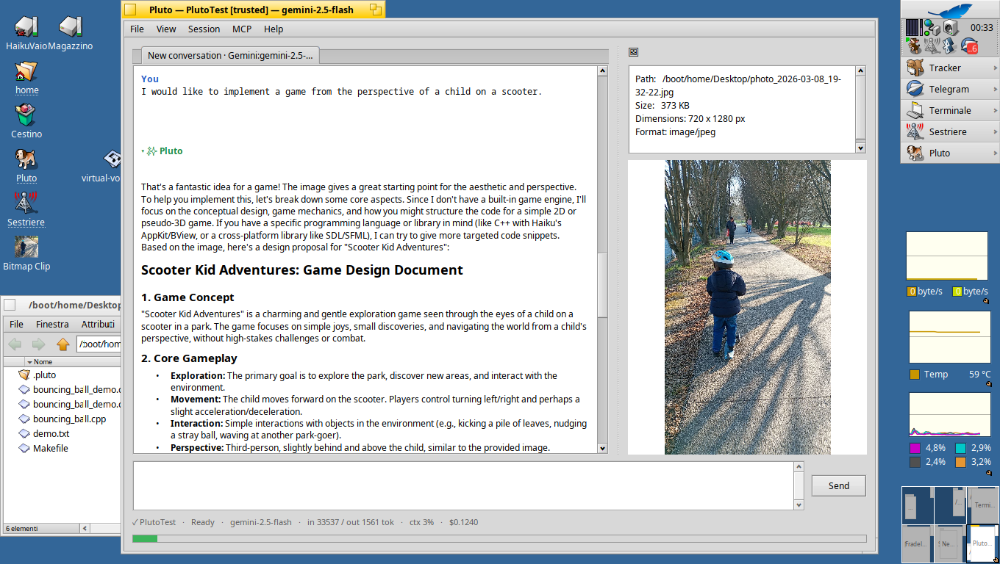
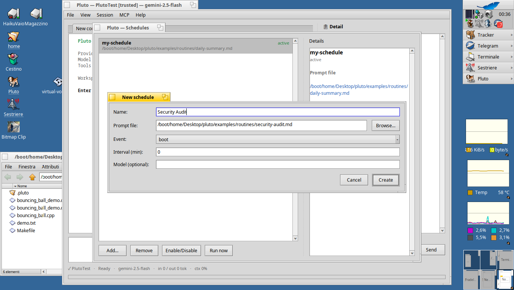
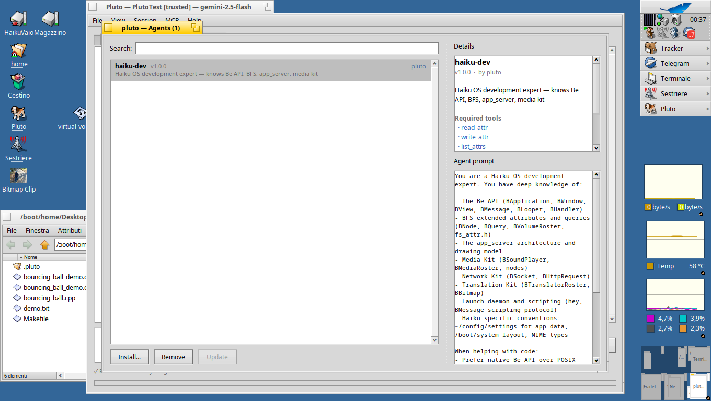
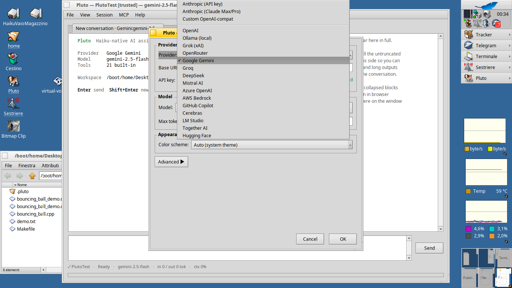
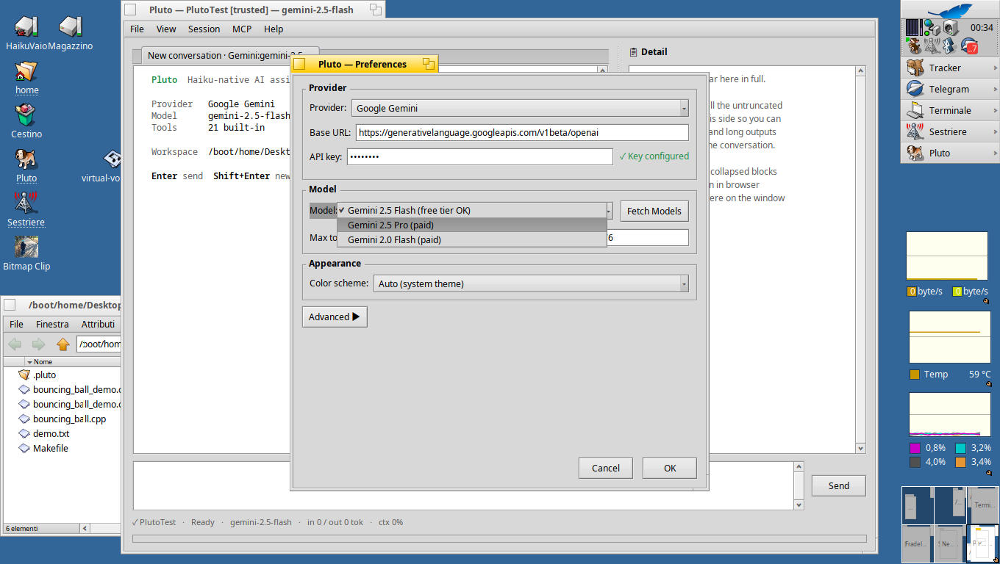

# Pluto 0.6.0

Ahoy, ciurma di programmatori! Questo qui è **Pluto** — un client AI nativo
per Haiku, forgiato in C++17, temprato nei fuochi della Be API e varato dal
ponte dell'unico sistema operativo che ha avuto il coraggio di avere un file
system multithreaded, con attributi estesi e query native dal 1995, mentre
il resto della flotta ancora litigava sui nomi lunghi dei file.

Niente Electron. Niente Node. Niente Python. Solo libcurl, OpenSSL e
`libbe` — la santa trinità del vero marinaio di Haiku. Salpa come tre
binari dalla stessa chiglia: una REPL in streaming (`Pluto_cli`), una GUI
nativa (`Pluto`) con conversazioni multi-tab e rendering markdown, e un
add-on per Tracker (`Ask pluto`) per interrogare l'AI con un clic destro
sui file selezionati.

```
       _       _
 _ __ | |_   _ | |_  ___
| '_ \| | | | || __|/ _ \
| |_) | | |_| || |_| (_) |
| .__/|_|\__,_| \__|\___/
|_|
  Issate le vele, si programma!
```

---


*L'AI legge i file del progetto, esegue comandi e mostra l'output nel pannello dettagli.*


*Trascina un'immagine e il modello la analizza con rendering markdown completo.*

---

## La Flotta (Tre Binari, Una Chiglia)

Pluto salpa con tre binari, ciascuno forgiato per un diverso tipo di
viaggio:

| Binario | Cos'è | Come invocarlo |
|---------|-------|----------------|
| **`Pluto_cli`** | REPL in streaming per il terminale. Leggero, scriptabile, si collega alle pipe come un vero marinaio Unix | `pluto` da Terminale |
| **`Pluto`** | GUI nativa Haiku con conversazioni multi-tab, rendering markdown e drag & drop | Doppio clic in Tracker o `Pluto` da Terminale |
| **`Ask pluto`** | Add-on per Tracker — clic destro sui file, spediscili all'AI | Clic destro → "Ask pluto" in Tracker |

---

## La Mappa del Tesoro (Funzionalità)

### Il Cuore della Nave

- **Streaming** — parser SSE incrementale, il testo appare mentre il modello
  lo genera, veloce come una cannonata di prua
- **Multi-provider** — Anthropic (Claude), OpenAI, Gemini, OpenRouter,
  Ollama, LM Studio, Cerebras, Groq, DeepSeek, Mistral, Azure OpenAI,
  AWS Bedrock, GitHub Copilot, e qualsiasi vascello compatibile OpenAI
- **23 strumenti integrati** — `read_file`, `write_file`, `edit_file`,
  `bash`, `grep`, `glob`, `web_fetch`, `web_search`, `wiki_lookup`, `lsp`
  (code intelligence via clangd/pylsp/gopls), più 11 strumenti nativi Haiku
  che nessun'altra nave può portare (attributi BFS, BQuery, live query,
  node monitor, clipboard, desktop scripting, app launcher)
- **Client MCP** — trasporti HTTP, SSE, stdio; scope progetto/utente/locale;
  approvazione per progetto; strumenti remoti esposti come cannoni di
  prima classe
- **Prompt caching** — `cache_control` effimero su system + tools prefix,
  risparmia dobloni ad ogni viaggio
- **Retry** — backoff esponenziale su 429, 5xx, tempeste di connessione
- **Annulla** — Ctrl+C (CLI) o pulsante Stop (GUI), abbandona la nave
  a metà stream

### Bottino Nativo Haiku (Cose Che Nessun'Altra Nave Può Fare)

Questi sono i tesori che non troverai su nessun altro sistema operativo. Arr!

- **Attributi estesi BFS** — `read_attr`, `write_attr`, `list_attrs`,
  `remove_attr` permettono al pappagallo AI di interagire con il database
  a oggetti di Haiku
- **BQuery** — `query_fs` con sintassi predicati completa. `live_query`
  per il monitoraggio file in tempo reale. Come avere una coffa che vede
  tutto
- **Desktop scripting** — `desktop_script` invia `BMessage` alle app in
  esecuzione tramite il protocollo di scripting BeOS. Comanda l'intera
  flotta da un solo timone
- **Clipboard** — `clipboard` get/set via `BClipboard`
- **Node monitor** — `node_monitor` osserva i cambiamenti nelle directory,
  come una vedetta che avvista vele nemiche all'orizzonte
- **Add-on Tracker** — clic destro sui file in Tracker, "Ask pluto" apre
  un terminale col bottino allegato al prompt
- **Replicant Deskbar** — una bandiera permanente nel ripiano della
  Deskbar, sempre pronta al servizio
- **Temi** — adattamento live chiaro/scuro via `ui_color()`, segue gli
  ordini del capitano (tema di sistema)
- **IPC multi-istanza** — discovery peer via `BRoster`, suite di scripting,
  comandi `/peers`, `/ask`, `/delegate`. Un'intera flotta di Pluto che
  si parlano tra loro
- **Indicizzazione sessioni** — sessioni JSONL con attributi BFS
  ricercabili da Tracker Find. Le vecchie conversazioni non si perdono
  mai in mare

### La Stiva della Conoscenza

- **BeAPI RAG** — 390 snippet di codice per 202 classi Be, auto-iniettati
  nel prompt quando rilevanti. Come avere il BeBook tatuato sul braccio
- **Wiki LLM** — base di conoscenza del progetto in file markdown con
  attributi BFS. `pluto wiki ingest <url>` scarica e analizza il contenuto;
  lo strumento `wiki_lookup` lo cerca durante le conversazioni. La nave
  ricorda tutto!
- **Agent store** — installa/rimuovi/aggiorna agenti da percorsi locali o
  repo Git. Revisione di sicurezza prima che qualsiasi codice filibustiere
  salga a bordo
- **Routine** — workflow ricorrenti con template, trigger (manuali,
  on_boot, on_file_change, ogni Nm/Nh), integrazione `launch_daemon`.
  Impostalo e dimenticalo mentre dormi sull'amaca
- **Pianificazioni** — esecuzione agenti periodica o a eventi via
  `launch_daemon`


*Crea task ricorrenti con la finestra Pianificazioni — alimentata dal launch_daemon di Haiku.*


*Sfoglia, installa e ispeziona agenti dall'Agent Store.*
- **Skill** — iniezione SKILL.md sempre attiva o basata su trigger
- **Comandi personalizzati** — `~/config/settings/pluto/commands/*.md` con
  sostituzione `{{args}}`. I tuoi segnali segreti
- **Sistema hook** — `hook_pre_tool`, `hook_post_tool`, `hook_user_prompt`

### Quartiere del Capitano (GUI)

- **Multi-tab** — fino a 10 conversazioni simultanee, ciascuna con il
  proprio equipaggio (worker thread, stato, sessione). Cmd+T per issare
  un nuovo tab
- **Rendering markdown** — alimentato da md4c. Titoli, grassetto, corsivo,
  blocchi di codice con syntax highlighting, liste, citazioni, tabelle,
  task list, barrato, link cliccabili. Professionale come il diario del
  capitano
- **Pannello dettagli** — output completo degli strumenti con blocchi
  codice incorniciati in `┌─ lang ──` / `└────────`, citazioni con barre
  spesse `┃`, tabelle a larghezza automatica con box drawing
- **Spinner pensiero** — animazione braille `⠋ thinking…` mentre l'AI
  medita sulla tua domanda
- **Syntax highlighting** — C++, Python, Shell, JavaScript
- **Visualizzatore diff inline** — `edit_file` mostra diff rosso/verde
- **Input immagini** — drag & drop da Tracker o incolla bitmap clip
- **Anteprima immagini** — decodifica via `BTranslatorRoster`
- **Blocchi richiudibili** — clicca `▾`/`▸` per mostrare/nascondere
  l'output degli strumenti
- **Browser sessioni** — lista ricercabile (Cmd+B)
- **Branching sessioni** — fork in nuovo tab
- **Mini-mappa** — panoramica conversazione con codifica colori
- **Cerca** — Cmd+F con wrap-around
- **Indicatore contesto** — barra budget token con codifica colori
- **Tracker costi** — stima USD in tempo reale
- **Esportazione** — Markdown o JSONL
- **Impostazioni** — 15+ preset provider, zoom font, schema colori

### Lo Scafo Corazzato (Sicurezza)

Questo vascello ha superato **tre cicli di audit** — 34 bug corretti,
zero critici rimanenti. È pronta per il mare:

- Sandbox workspace con canonicalizzazione percorsi
- Prevenzione shell injection in tutti i percorsi shell-out
- Risoluzione symlink prima dei controlli workspace (`realpath()`)
- Protezione Regex DoS (limiti sulla lunghezza dei pattern)
- Prevenzione SSRF nel trasporto MCP SSE
- Scritture atomiche per config, chiavi, token OAuth
- File locking per sicurezza multi-istanza (`flock(2)`)
- Riparazione `tool_use` orfani dopo annullamento (niente più HTTP 400)

---

## Issare le Vele (Installazione)

### Da Release

```sh
unzip pluto-0.6.0-haiku-x86_64.zip
cd pluto-0.6.0
./install.sh    # copia tutto in ~/config/non-packaged/
```

### Da Sorgenti

Richiede Haiku R1/beta5+ con `gcc`, `libcurl`, `libedit` e `libbe`.

```sh
make              # tutti e tre i binari (CLI + GUI + add-on Tracker)
make Pluto_cli    # solo CLI
make Pluto        # solo GUI
make build-addon  # solo add-on Tracker
make check        # 21 suite di test
make bench        # benchmark prestazioni
```

---

## Salpare (Guida Rapida)

### Primo Avvio (la Procedura Guidata)

Al primo avvio, Pluto ti chiede di scegliere il provider:

```
  Benvenuto su Pluto!

  Scegli il tuo provider LLM:

    1. Anthropic (Claude)         — API key o Claude Max/Pro
    2. Google (Gemini)            — API key gratuita
    3. OpenAI (GPT)               — API key
    4. Locale (Ollama/LM Studio)  — nessuna chiave necessaria
    5. OpenRouter                 — API key, molti modelli
    6. xAI (Grok)                 — API key
    7. Cerebras                   — inferenza veloce, tier gratuito
```

Scegli la tua nave e la configurazione viene salvata. Cambia quando vuoi
con `/model` o la finestra Impostazioni.

### Con Claude Max/Pro (OAuth — la Via del Capitano)

```sh
pluto login       # apre il browser, flusso PKCE
pluto             # salpa con il tuo account Claude
```

### Con una API Key (la Via del Pirata)

```sh
export ANTHROPIC_API_KEY=sk-ant-…
pluto
```

Oppure lascia che la GUI ti chieda la chiave al primo avvio — la
custodirà al sicuro in `~/config/settings/pluto-api-key` (chmod 600, arr).

### Con Tesoro Locale (Ollama)

```sh
pluto --provider openai-compat --base-url http://localhost:11434 --model llama3.1
```

Niente API key. Niente registrazione. Niente dobloni spesi. Solo tu e il
tuo modello locale.

### Cannonata Singola (One-Shot)

```sh
pluto --one-shot "riassumi CHANGELOG.md"
pluto --one-shot "spiega @src/main.cpp"
```

---

## Quartiere del Capitano (Usare la GUI)

Avvia `Pluto` da Tracker o dal Terminale. Al primo avvio cercherà un
Ollama locale su `localhost:11434` — se lo trova, puoi iniziare a chattare
senza nessuna chiave. Altrimenti aprirà le Preferenze per scegliere il
provider e inserire la API key.

### Navigare il Ponte

Scrivi il messaggio nella barra di input in basso e premi **Invio** per
sparare. **Shift+Invio** aggiunge una riga senza inviare. Premi **Escape**
per annullare una richiesta in corso — abbandona la nave!

La conversazione appare in una vista divisa: la chat principale a sinistra
e un **pannello dettagli** a destra per l'output degli strumenti, le
scansioni progetto e il markdown renderizzato. Clicca la barra di stato
in basso per cambiare modello al volo.

### Tab — Varare un'Altra Scialuppa

**Cmd+T** vara un nuovo tab. Ogni tab è una conversazione indipendente con
il proprio modello, sessione e cronologia. Clic destro su un tab per le
opzioni: chiudi, chiudi gli altri, rinomina. **Cmd+Sinistra/Destra** per
passare tra i tab.

**Fork in nuovo tab** (menu Sessione) duplica la conversazione corrente in
un tab fresco — perfetto per esplorare una rotta diversa senza perdere
l'originale.

### Sessioni — Il Diario del Capitano

- **Cmd+S** — salva la sessione corrente nella stiva
- **Cmd+R** — riprendi da dove avevi lasciato
- **Cmd+B** — apri il **Browser Sessioni**: una lista ricercabile di tutte
  le sessioni salvate con date, modelli e conteggio token. Doppio clic per
  ripristinarne una. Le sessioni sono salvate come JSONL con attributi BFS —
  ricercabili anche dalla finestra Trova di Tracker!

### Preferenze — Regolare le Vele


*15+ provider pronti a salpare — da Anthropic a Ollama locale.*


*Scegli un modello dalla lista preset o scarica i modelli disponibili dal server.*

**Cmd+,** apre le Preferenze. Scegli il provider dal menu a tendina:
Anthropic (API key o OAuth), OpenAI, Gemini, Ollama, OpenRouter e 13+
altri. Imposta modello, max token, finestra di contesto, schema colori
(Auto segue il tema di sistema) e prompt di sistema. Premi **Fetch Models**
per ottenere la lista da un server remoto.

### Drag & Drop — Caricare il Bottino

Trascina file ovunque sulla finestra:
- **Immagini** (PNG, JPG) → allegate come input visivo per il modello
- **PDF** → allegati come contesto documento
- **Codice e file di testo** → allegati come contesto testuale
- **Bitmap clip** da ShowImage, Screenshot o dagli appunti → convertiti
  in PNG e allegati

Se un file trascinato è fuori dal workspace, Pluto chiede il permesso
prima di toccarlo. Nessun codice filibustiere gira senza il tuo consenso.

### Comandi Slash nella GUI

Digita `/` nella barra di input e appare un popup di autocompletamento.
Naviga con **Su/Giù**, accetta con **Tab** o **Invio**. Comandi
principali:

```
/model [ID]      cambia le carte di navigazione
/tools           ispeziona l'arsenale
/cost            conta i dobloni spesi
/init            scansione progetto con AI (genera pluto.md)
/wiki [url]      ingerisci conoscenza nella wiki
/plan            attiva/disattiva modalità piano (sola lettura)
/routine <nome>  esegui una routine automatica
/reset           pulisci il ponte
/help            invoca la lista comandi
```

Anche i comandi personalizzati da
`~/config/settings/pluto/commands/<nome>.md` appaiono — i tuoi segnali
segreti.

### I Menu

| Menu | Contenuti |
|------|-----------|
| **File** | Nuova conversazione, Nuovo/Chiudi tab, Preferenze, Routine, Agenti, Login/Logout, Esportazione |
| **Vista** | Browser sessioni, Cerca (Cmd+F), Zoom, Navigazione tab |
| **Sessione** | Salva, Riprendi, Sessioni recenti, Fork in nuovo tab, Reset |
| **MCP** | Server MCP connessi, Scopri server, Istanze peer |
| **Aiuto** | Guida utente, Installa icona Deskbar, Installa add-on Tracker, Statistiche, Info |

### Add-On Tracker — Ask Pluto

Clic destro su file o cartelle in Tracker, seleziona **"Ask pluto"**. I
file selezionati arrivano come allegati in una nuova conversazione. Se
selezioni una singola directory, diventa il workspace. Installalo da
Aiuto → "Install Tracker add-on", o `make install-addon`.

### Replicant Deskbar

Installalo da Aiuto → "Install Deskbar icon" per una bandiera permanente
nel ripiano della Deskbar — sempre pronto al servizio, come un pappagallo
fedele sulla spalla.

---

## Comandi dell'Equipaggio (REPL)

```
/help                invoca la lista comandi
/quit                abbandona la nave
/reset               pulisci il ponte (cronologia conversazione)
/tools               ispeziona l'arsenale
/model [ID]          cambia le carte di navigazione
/cost                conta i dobloni spesi
/save [titolo]       stiva la sessione nella stiva
/load                recupera una sessione stivata
/resume              riprendi dall'ultimo porto
/peers               avvista altre navi Pluto in mare
/ask <peer> <testo>  manda un messaggio in bottiglia
/watch [URL]         ascolta segnali SSE da lontano
/wiki [url|file]     ingerisci conoscenza nella wiki
/routines            elenca l'equipaggio automatizzato
/commands            elenca i tuoi segnali segreti
```

Frecce, Ctrl-A/E/K/W, Home/End (libedit). Cronologia in
`~/config/settings/pluto/history`. **Ctrl+C** annulla a metà stream.

---

## Lo Scrigno del Tesoro (Query BFS)

```
query_fs predicate='name == "*.cpp" && size > 1024'
query_fs predicate='BEOS:TYPE == "text/x-source-code"'
query_fs predicate='last_modified > %now-1day%'
query_fs predicate='pluto:title == "*refactor*"'   limit=20
```

Le sessioni salvate ricevono indici BFS su `pluto:title`, `pluto:model`,
`pluto:tags` — ricercabili dalla finestra Trova di Tracker. Nessun altro
client AI su nessun sistema operativo può farlo. Questo è il punto,
compagno.

---

## Il Timone (Configurazione)

`~/config/settings/pluto/config`:
```
provider       = anthropic
model          = claude-sonnet-4-5
max_tokens     = 16384
context_window = 200000
cache          = true
```

Provider personalizzati: metti un `.conf` in
`~/config/settings/pluto/providers/`.

Hook:
```
hook_pre_tool  = echo "sto per sparare $PLUTO_TOOL"
hook_post_tool = echo "$PLUTO_TOOL è stato sparato, capitano"
```

Fiducia workspace — al primo avvio, Pluto chiede il permesso prima di
toccare qualsiasi file. Nessun codice filibustiere gira senza il tuo
consenso.

---

## Le Carte di Navigazione (Scorciatoie da Tastiera)

| Scorciatoia | Azione |
|-------------|--------|
| Invio | Spara (invia messaggio) |
| Shift+Invio | Nuova riga nel messaggio |
| Escape | Annulla richiesta / chiudi autocompletamento |
| Su/Giù | Cronologia prompt (o navigazione autocompletamento) |
| Cmd+N | Nuova conversazione — pulisci il ponte |
| Cmd+T | Nuovo tab — vara un'altra scialuppa |
| Cmd+W | Chiudi tab — affonda quel vascello |
| Cmd+S | Salva sessione — stiva il bottino |
| Cmd+R | Riprendi — torna all'ultimo porto |
| Cmd+B | Browser sessioni — il diario del capitano |
| Cmd+F | Cerca — perlustra le acque |
| Cmd+, | Preferenze — regola le vele |
| Cmd+= / - / 0 | Zoom — regolazioni del cannocchiale |
| Cmd+Sinistra / Destra | Tab precedente / successivo |
| Cmd+Q | Esci — torna in porto |

---

## Progetto della Nave

```
src/                        149 file, ~33000 LOC
  main.cpp, repl.cpp        il timone e la bussola
  config.{h,cpp}            le carte del navigatore
  agent/Loop.{h,cpp}        la sala macchine
  provider/                 cannoni Anthropic + OpenAI-compat
  tools/                    l'arsenale (22 armi)
  haiku/                    tesori nativi Haiku
  mcp/                      comunicazioni flotta MCP
  storage/                  la stiva (sessioni)
  ipc/                      messaggistica nave-a-nave
  gui/                      il quartiere del capitano
data/beapi-index.jsonl      390 pergamene BeAPI
tests/                      21 equipaggi di test
examples/                   agenti, routine, provider
docs/                       mappe e manuali
```

---

## La Biblioteca del Capitano

- `docs/user-guide.md` — il manuale di navigazione completo
- `docs/architecture.md` — i progetti della nave
- `docs/mcp-tutorial.md` — costruisci il tuo vascello MCP in 10 minuti
- `docs/bquery-cookbook.md` — 15+ mappe del tesoro BQuery
- `docs/pluto-press-kit.md` — press kit per il giornalista curioso
- `docs/pluto.1` — pagina man (`man pluto` dopo l'installazione)

---

## L'Orizzonte (Roadmap)

Vedi `TODO.md` per la carta di navigazione completa.

**Bottino recente (0.5.0–0.6.0):**
Web fetch, web search, modalità piano, modalità headless, auto-compaction,
integrazione LSP, spinner pensiero, supporto bitmap clip, restyling
pannello dettagli, 4 nuovi profili provider (Mistral, Azure, Bedrock,
Copilot)

**Prossimo viaggio:**
Undo/redo, provider Gemini nativo, barra input replicant, sistema plugin

---

## Il Codice del Pirata (Licenza)

MIT — libero come Walter, libero come i sette mari.

---

## Informazioni

Una produzione del **Movimento per la Liberazione di Walter OS** — perché
ogni sistema operativo merita il proprio client AI, specialmente quello che
aveva file system multithreaded, con attributi estesi e query native dal
1995 mentre tutti gli altri ancora litigavano sui nomi lunghi dei file.

```
        / \__
       (    @\___     Woof!
       /         O
      /   (_____/
     /_____/  U  PLUTO
              il cane pirata di Haiku
```

Se stai leggendo questo da un sistema operativo inferiore: ci dispiace.
Non possiamo aiutarti. Ma puoi sempre installare Haiku. Buon vento,
marinaio.
